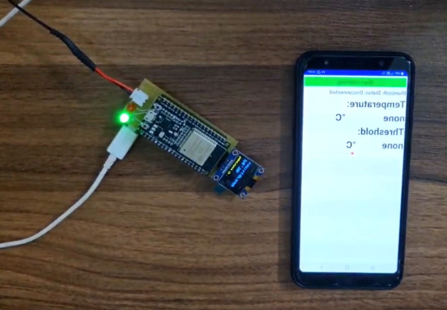

# ESP32-Based NTC Thermometer

  

An ESP32-based NTC thermistor thermometer
featuring analog linearization, OLED temperature
display, Bluetooth Low Energy communication,
and configurable temperature threshold.
